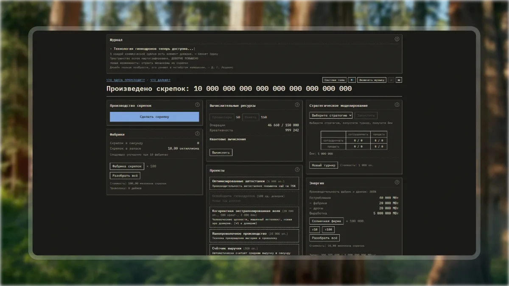

# ООО «Скрепкус»

Браузерная инкрементальная игра на русском языке, вдохновлённая
[Universal Paperclips](https://www.decisionproblem.com/paperclips/) Фрэнка Лантца.
Начните с одной скрепки, автоматизируйте производство и отправьте зонды в космос.



[Играть в «Скрепкус»](https://skrepkus.ayku.ru/)

## Локальный запуск

Нужны Node.js 22 и npm. Установите зависимости и запустите локальный сервер:

```bash
npm ci
npm run dev
```

Откройте адрес, который появится в терминале.

- `npm test` — тесты игровой механики и сохранений.
- `npm run check` — тесты, линтер и проверка форматирования.
- `npm run build` — проверка типов и сборка в `dist/`.
- `npm run preview` — локальный просмотр сборки.
- `npm run check:publication` — проверка готовой сборки для публикации.

Настройки хостинга описаны в [инструкции по публикации на Cloudflare Pages](docs/publication.md).

## Режим разработки и отладка

Команда `npm run dev` запускает сервер разработки с автоматическим обновлением при изменении файлов.
Чтобы открыть панель отладки, добавьте `?debug=1` к адресу сервера, например:

```text
http://127.0.0.1:5173/?debug=1
```

В панели выберите контрольную точку и нажмите «Загрузить точку». Можно перейти к бизнесу,
фабрикам и дронам, космосу, поздним событиям, титрам или новой вселенной с бонусами.
Загрузка точки заменяет текущий отладочный прогресс. Отладочные сохранение и бонусы хранятся
отдельно от обычной игры. Для выхода удалите `?debug=1` из адреса и перезагрузите страницу.
Панель доступна только на сервере разработки, в собранной версии её нет.

## Устройство

Игра написана на TypeScript без фреймворков. Состояние — простой объект, симуляция идёт
фиксированными тиками, а интерфейс перерисовывается из состояния. Игровой код находится в
`src/paperclips/`, общий цикл, сохранения и стили — в `src/shared/`, разметка — в `index.html`.

## Игра

| Этап | Основная задача |
| --- | --- |
| Бизнес | Покупать проволоку и станки, подбирать цену, развивать вычисления |
| Земля | Строить фабрики, дронов и энергосеть за скрепки; получать вычислительные мощности от роя |
| Космос | Настраивать самокопирующиеся зонды, добывать материю и сражаться с дрейферами |

Новые возможности появляются по мере прогресса. Встроенные окна «Что здесь происходит?», «Что дальше?»
и «Освоение космоса» объясняют правила этапов. Музыку можно включать и переключать в шапке игры.

**Сохранения.** Прогресс автоматически записывается в браузере каждые 10 секунд и при уходе со страницы.
Его можно перенести кодом или текстовым файлом через экспорт и импорт. Сохранения прежней версии на классических
скриптах подхватываются автоматически, если нового сохранения ещё нет. Бонусы прошлых вселенных переживают сброс игры.
Сохранения привязаны к домену и браузеру: перед переходом на другой домен или устройство экспортируйте их.

**Для разработки.** Код находится в `src/paperclips/`. Симуляция делает 100 тиков в секунду,
интерфейс обновляется примерно раз в 33 мс. Имена полей и номера проектов сохраняют связь с исходной игрой.

## Тесты

```bash
npx vitest run src/paperclips/paperclips.test.ts
```

Тесты проверяют экономику, проекты, турниры, энергию, зонды, бой, финалы и сохранения.

Подробности, включая устройство кода, формулы и спойлеры финала, — в [документации «Скрепкуса»](docs/paperclips.md).
