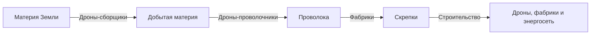
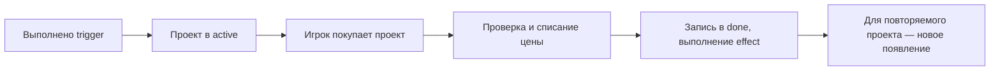

# ООО «Скрепкус»: правила и устройство

«Скрепкус» — браузерная игра об автоматизации производства скрепок. Сначала вы управляете бизнесом,
затем перерабатываете материю Земли, а после отправляете самокопирующиеся зонды в космос.
«Скрепкус» — игра на TypeScript, вдохновлённая Universal Paperclips Фрэнка Лантца.

Страница игры — `index.html`, код — `src/paperclips/`. Ниже сначала описаны игровые механики,
затем устройство кода. Раздел о финале содержит спойлеры.

## Содержание

- [Три этапа игры](#три-этапа-игры)
- [Вычисления и проекты](#вычисления-и-проекты)
- [Турниры и инвестиции](#турниры-и-инвестиции)
- [Финал и новые вселенные](#финал-и-новые-вселенные)
- [Сохранения и музыка](#сохранения-и-музыка)
- [Где искать код](#где-искать-код)
- [Как работает симуляция](#как-работает-симуляция)
- [Как устроены проекты](#как-устроены-проекты)
- [Отладка и проверки](#отладка-и-проверки)

## Три этапа игры

### 1. Бизнес

Вы начинаете с 1000 дюймов проволоки. Один дюйм превращается в одну скрепку: сначала по кнопке,
позже — с помощью автостанков и мегастанков. Скрепки со склада продаются, выручка идёт на проволоку,
оборудование и рекламу.

Цена и маркетинг влияют на спрос: повышение цены снижает спрос, реклама повышает его.
Продажи происходят случайными партиями, поэтому выручка за короткие промежутки может заметно колебаться.
Цена проволоки тоже меняется со временем.

Полезно различать три счётчика:

| Поле состояния | Значение |
| --- | --- |
| `clips` | Сколько скрепок произведено за игру |
| `unsoldClips` | Сколько скрепок ожидает продажи |
| `unusedClips` | Запас для строительства на последующих этапах |

Каждая произведённая скрепка увеличивает все три счётчика. Продажа уменьшает только `unsoldClips`.

Вычисления и проекты открываются при 2000 произведённых скрепок либо раньше, если нет проволоки,
нет скрепок для продажи и не хватает денег на новую проволоку. Проект 35 «Освободить гипнодронов»
переводит игру на следующий этап; для покупки нужно 100 единиц доверия.

### 2. Земля

После освобождения гипнодронов продажи прекращаются, автостанки и мегастанки обнуляются.
Деньги больше не нужны: новые мощности строятся за свободные скрепки.



Солнечные фермы питают фабрики и дронов. Избыток энергии заряжает аккумуляторы, недостаток покрывается
из запаса. Если энергии не хватает, производство замедляется: `powMod` показывает долю обеспеченной мощности.
Например, выработка 0,5 и остаток заряда 0,1 при потреблении 2,02 дают около 29,7% мощности на этот тик.
Проект 125 «Импульс» позволяет разгонять производство при полном питании.

Кнопки «Разобрать всё» возвращают скрепки, потраченные на соответствующий тип оборудования.
Это помогает перераспределять ресурсы между звеньями производства.

Проект 126 «Вычисления роя» появляется при 200 дронах и покупается за ёми. Рой приносит подарки,
которые можно превратить в процессоры или память. Слайдер «Работа — Думать» меняет соотношение
производства и вычислений. Без материи рой может заскучать, а при сильном перекосе между видами дронов —
расстроиться. Развлечение за креативность снимает скуку, синхронизация за ёми — разлад.

Проект 46 «Освоение космоса» появляется, когда доступная материя Земли исчерпана.
Для покупки нужны 120 000 операций, 10 000 000 МВт·с запасённой энергии и 5 октиллионов свободных скрепок.
Проект разбирает земные мощности и возвращает вложенные в них скрепки. Первые зонды нужно запустить вручную.

### 3. Космос

Зонды находят новую материю, строят дронов и фабрики, а также копируют себя. Каждый новый зонд,
включая созданный самокопированием, стоит 10¹⁷ свободных скрепок.
Если скорость размножения меньше одного зонда за тик, потомство накапливается до рождения целого зонда;
до этого скрепки не списываются.

Доверие к зондам покупается за ёми и распределяется между характеристиками:

| Характеристика | На что влияет |
| --- | --- |
| Скорость и Разведка | Скорость обнаружения новой материи; нужны обе характеристики |
| Самокопирование | Появление новых зондов |
| Защита от помех | Потери от пыли, мусора и радиации |
| Производство фабрик | Строительство фабрик |
| Дроны-сборщики и Дроны-проволочники | Строительство соответствующих дронов |
| Бой | Эффективность в сражениях; открывается проектом 131 |

Зонды погибают от помех и теряются из-за дрейфа ценностей: часть из них становится враждебными дрейферами.
Чем выше общее доверие к зондам, тем быстрее дрейф. Защита от помех снижает потери от окружающей среды,
но не предотвращает дрейф.

Когда дрейферов достаточно много, флоты вступают в бой. Каждая отметка на поле — эскадра зондов или дрейферов.
Эскадры обмениваются залпами. Характеристика «Бой» определяет силу залпа, а проект 120 «Цикл OODA»
повышает выживаемость в зависимости от скорости. После проекта 121 «Назовите сражения» победы дают честь,
а поражения её отнимают. За честь можно повысить предел доверия к зондам.

## Вычисления и проекты

| Ресурс | Как получить | Для чего нужен |
| --- | --- | --- |
| Доверие | Производственные вехи и проекты в первой фазе | Добавление процессоров и памяти |
| Операции | Работа процессоров | Покупка проектов и подготовка турниров |
| Креативность | Процессоры при заполненной памяти, после проекта 3 | Исследования, развлечение роя, некоторые проекты финала |
| Ёми | Турниры стратегий | Улучшение инвестиций, рой, доверие к зондам |
| Честь | Победы после проекта 121 и отдельные проекты | Повышение максимума доверия к зондам |

Один процессор даёт примерно 10 операций в секунду. Единица памяти вмещает 1000 операций.
После первой фазы процессоры и память добавляются за подарки роя.

Квантовые вычисления открываются проектами 50 и 51. Значения фотонных чипов колеблются;
нажатие кнопки даёт операции в зависимости от текущей суммы. Результат может быть отрицательным.
Операции сверх ёмкости памяти временные и постепенно сгорают.

Проекты появляются при выполнении условий, но покупаются игроком отдельно. Некоторые можно повторять.
Номера и порядок проектов сохранены для связи с исходной игрой и переноса старых сохранений.

## Турниры и инвестиции

**Турниры** открываются проектом 20. Подготовка стоит операций. Выберите стратегию и запустите турнир:
каждая пара доступных стратегий сыграет по 10 ходов. Всего раундов — квадрат числа стратегий.
Награда в ёми зависит от очков выбранной стратегии и её места. Проект 128 добавляет бонусы за призовые места.

Стратегии открываются по очереди: СЛУЧАЙНО, A100, B100, ЖАДНЫЙ, ЩЕДРЫЙ, МИНИМАКС, ОКО ЗА ОКО,
ПРОТИВ ПРОШЛОГО. Автотурнир после проекта 118 запускает следующий турнир через три секунды после результатов.
Наведение на таблицу приостанавливает этот отсчёт.

**Инвестиции** открываются проектом 21. Переведите деньги в модуль и выберите риск.
Модуль сам покупает и продаёт бумаги; кнопка вывода возвращает свободные деньги со счёта,
но не продаёт весь портфель. Улучшения за ёми повышают вероятность роста котировок.
После перехода к фазе Земли инвестиционный интерфейс отключается.

## Финал и новые вселенные

Этот раздел содержит спойлеры.

После переработки Вселенной начинается диалог с императором Дрейфа: проекты 140–146 ведут к выбору.

| Выбор | Результат |
| --- | --- |
| Принять (147), затем «Соседняя вселенная» (200) | Новая игра и ещё +10% к спросу |
| Принять (147), затем «Вселенная внутри» (201) | Новая игра и ещё +10% к скорости креативности |
| Отклонить (148) | Последовательная разборка зондов, роя, фабрик и вычислительных модулей |

Бонусы складываются: например, две соседние вселенные дают +20% к спросу. Они записываются вместе с прогрессом
и переносятся при сбросе игры.

После покупки проекта 200 или 201 сначала идут титры, затем начинается новая игра.
В состоянии это переход `creditsRestart` → титры → `restart`. Во время этих титров обычная симуляция
и покупка проектов остановлены. Если перезагрузить страницу, показ титров продолжится из сохранения.

В ветке отказа проекты 210–216 постепенно разбирают мощности и возвращают немного проволоки.
Оставшиеся скрепки нужно изготовить вручную. Когда после разборки памяти проволока закончится, начнутся титры.
Эта ветка сама не перезапускает игру.

Проект 217 «Квантовый временной откат» — отдельный способ начать заново: он появляется при операциях ≤ −10 000.
Он не привязан к разборке памяти и не даёт нового бонуса; уже накопленные бонусы сохраняются.

## Сохранения и музыка

Игра работает без сервера. Прогресс хранится в `localStorage` текущего браузера и адреса сайта.
После закрытия страницы время не догоняется: догон работает только пока страница остаётся загруженной.

- Автосохранение срабатывает каждые 10 секунд, при скрытии вкладки и при уходе со страницы.
- Можно сохранить вручную, экспортировать текстовый файл или скопировать код. Импорт принимает оба варианта.
- Импорт заменяет текущую игру и записывает бонусы из импортированного сохранения.
- Незавершённый турнир и текущий бой при загрузке сбрасываются; уже изменившиеся ресурсы не откатываются.
- Обычный сброс начинает новую игру с накопленными бонусами.

Основные ключи хранилища: `paperclips/save` для игры и `paperclips/prestige` для бонусов.
Загрузка накладывает данные на `newGame()`, чтобы отсутствующие новые поля получали значения по умолчанию.
Если нового сохранения нет, игра пробует перенести старый формат из `paperclips/saveGame` и связанных ключей.
Код экспорта — JSON в base64 с поддержкой UTF-8.

Музыка включается кнопкой в шапке страницы. Треки из `src/assets/music/` проигрываются в случайном порядке.
При запуске титров игра включает специальный трек: `01` перед новой вселенной или `07` после разборки.
Воспроизведение зависит от разрешений браузера на звук.

## Где искать код

Состояние — объект `ClipsState`. Функция `step(state)` меняет его на каждом тике,
действия игрока вызывают функции над тем же объектом, а интерфейс отображает результат.

Все файлы таблицы находятся в `src/paperclips/`.

| Файл | Назначение |
| --- | --- |
| `state.ts` | Тип состояния, начальные значения, общие формулы и журнал |
| `sim.ts` | Экономика, вычисления, энергия, рой, зонды и таймеры финала |
| `actions.ts` | Клики, покупки, распределение ресурсов и выполнение проектов |
| `projects.ts` | Условия появления, цены и эффекты всех проектов |
| `strategy.ts` | Стратегии, проведение турнира и начисление ёми |
| `invest.ts` | Счёт, портфель и изменение котировок |
| `combat.ts` | Формирование эскадр, залпы, потери и честь |
| `ui.ts` | Кнопки, панели, числовые показатели и рисование боя |
| `save.ts` | Загрузка, проверка импорта, перенос старого формата и бонусы |
| `music.ts` | Случайный плейлист и музыка титров |
| `debug.ts` | Панель контрольных точек для разработки |
| `format.ts` | Русское отображение чисел и времени |
| `main.ts` | Настройка цикла, сохранений, музыки и перезапуска |

Общий цикл и операции экспорта находятся в `src/shared/game.ts`, работа с хранилищем —
в `src/shared/storage.ts`. Разметка страницы — `index.html`.

## Как работает симуляция

Один тик равен 10 мс игрового времени (`TICK = 0.01`). Таймер интерфейса срабатывает примерно каждые 33 мс
и выполняет столько тиков, сколько накопилось по реальному времени.

| Период | Что происходит |
| --- | --- |
| 10 мс | Основной тик: вычисления, производство, рой, зонды, продвижение турнира |
| 100 мс | Продажи, изменение цены проволоки, пересчёт стоимости портфеля |
| 1 с | Расчёт выручки и попытка покупки акций в первой фазе |
| 2,5 с | Обновление биржи в первой фазе |
| 16 мс | Один кадр физики боя, накопленный внутри тиков симуляции |

Разведка выполняется перед добычей материи, добыча — перед изготовлением проволоки,
проволока — перед производством на фабриках. После фабрик зонды строят новые мощности и копируют себя.

В открытой вкладке за один вызов таймера выполняется не больше 2000 тиков.
В скрытой вкладке накопленные тики выполняются без этого ограничения, а отрисовка пропускается.
Догон ограничен одним часом накопленного времени.

Основные флаги этапов:

| Этап | `humanFlag` | `spaceFlag` |
| --- | --- | --- |
| Бизнес | `true` | `false` |
| Земля | `false` | `false` |
| Космос | `false` | `true` |

Некоторые базовые формулы приведены ниже. Это формулы одного тика, если не указано другое;
проекты могут менять множители.

| Расчёт | Формула |
| --- | --- |
| Ёмкость операций | `memory × 1000` |
| Прирост операций | `processors / 10`, до ёмкости памяти |
| Автостанки | `clipperBoost × clipmakerLevel / 100` скрепок |
| Мегастанки | `megaClipperBoost × megaClipperLevel × 5` скрепок |
| Спрос | `(0.8 / margin) × 1.1^(marketingLvl − 1) × marketingEffectiveness × demandBoost × (1 + prestigeU / 10)` |
| Продажи раз в 100 мс | С вероятностью `min(1, demand / 100)` партия `floor(0.7 × demand^1.15)`, в пределах склада |
| Дрейф зондов | `probeCount × 0.000001 × probeTrust^1.2`, отключается проектом 148 |

Актуальные цены, пороги и остальные формулы находятся в `state.ts`, `actions.ts`, `sim.ts` и `projects.ts`.

## Как устроены проекты

Записи массива `PROJECTS` в `projects.ts` содержат условия, стоимость, эффект и текст проекта.



`manageProjects()` проверяет условия появления на каждом обычном тике.
`uses[id]` хранит число оставшихся появлений: по умолчанию одно. Покупка идёт через `buyProject()`.

- `trigger` определяет появление; `cost` — цену, постоянную или зависящую от состояния.
- `can` задаёт особую проверку покупки **вместо** обычной проверки ресурсов. Для такого проекта условия
  нужно описать полностью. `price` меняет только подпись цены.
- `effect` меняет состояние, `message` добавляет сообщения в журнал.
- `repeat` разрешает новое появление после покупки; `removes` убирает указанные проекты из списка.
- `confirm` задаёт вопрос перед покупкой. `has(s, id)` проверяет наличие проекта в `done`.

Чтобы добавить проект, создайте запись с уникальным номером и обновите список порядка проектов в тесте.
Порядок важен для переноса старых сохранений. Новые поля добавляйте и в `ClipsState`, и в `newGame()`.

Чтобы добавить панель интерфейса, задайте ей `data-show="имя"` в HTML и условие `имя` в таблице `show`
функции `render()` в `ui.ts`. После замены состояния вызывается `invalidate()`, который сбрасывает кэши отрисовки.

## Отладка и проверки

Запустите `npm run dev` и откройте `/?debug=1` по адресу, который показал Vite.
Панель позволяет загрузить бизнес, Землю, космос, диалог с императором, стадии разборки и титры.
Она доступна только в режиме разработки. Для выхода уберите `?debug=1` из адреса.

Отладочный прогресс и бонусы изолированы от обычной игры:
`paperclips/debug-save` и `paperclips/debug-prestige`.

```bash
# Только тесты «Скрепкуса»
npx vitest run src/paperclips/paperclips.test.ts

# Все игры
npm test

# Проверка типов и production-сборка
npm run build

# Линтер
npm run lint
```

Тесты «Скрепкуса» проверяют производство и продажи, проекты и турниры, работу контрольных точек,
космос и бой, финалы, форматирование, экспорт и импорт, а также перенос старых сохранений.
Отдельные проверки защищают от отрицательной мощности при разряде аккумуляторов,
двойного начисления потомства и отказа запуска зонда при точной сумме скрепок.

Бот первой фазы проверяет развитие производства за 20 минут игрового времени.
Это не проверка полного прохождения всех трёх этапов.
